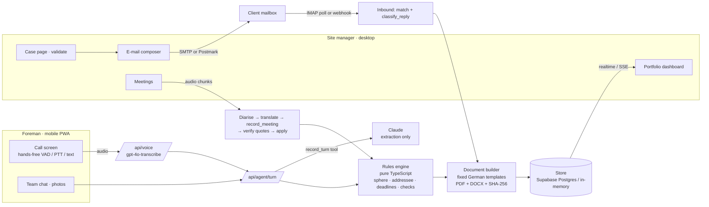

# Klara: the operating system for construction site documentation

> **Hackathon Challenge B: "AI Site Manager Assistant for Documentation, Daily Reports and Claims"**
> Team **Build Different**

Klara is an AI assistant for German construction companies. A foreman **calls Klara in his own language** and describes what happened on site. Klara recognises the legal situation, asks only for the missing facts, decides **whose risk it is** with deterministic rules, and writes the **correct German document** (e.g. a *Behinderungsanzeige* under § 6 VOB/B). The site manager reviews it, sends it by e-mail in one step, and when the client replies, Klara **reads the answer and drafts the next letter**. Daily reports, meeting minutes and a live portfolio dashboard run on the same case engine.

**Klara is more than a dictation tool or a letter generator.** Calls, meetings and e-mails come in; legally sound German documents, tracked deadlines and live risk go out, and every case is followed until it is closed.

| | |
|---|---|
| **Live app** | https://klara-liard.vercel.app (password-protected; credentials are in the submission form) |
| **Live demo flow** | `/demo`: title → live call → office → meeting notes → closing slide |
| **Pitch deck** | `/pitch` (full-screen, runs offline) |

---

## Contents

1. [Summary for reviewers](#1-summary-for-reviewers)
2. [The problem](#2-the-problem)
3. [The solution: one case lifecycle](#3-the-solution-one-case-lifecycle)
4. [Coverage of the challenge brief](#4-coverage-of-the-challenge-brief)
5. [What makes Klara different](#5-what-makes-klara-different)
6. [Architecture](#6-architecture)
7. [Quality and testing](#7-quality-and-testing)
8. [Responsible AI, law and data protection](#8-responsible-ai-law-and-data-protection)
9. [Business viability](#9-business-viability)
10. [Tech stack](#10-tech-stack)
11. [Run it locally (5 minutes, no keys needed)](#11-run-it-locally-5-minutes-no-keys-needed)
12. [Repository structure](#12-repository-structure)
13. [Known limitations](#13-known-limitations)
14. [Roadmap](#14-roadmap)
15. [Team](#15-team)

---

## 1. Summary for reviewers

| Criterion | Evidence in this repo |
|---|---|
| **Completeness against the brief** | All 6 objectives and all 5 use cases of Challenge B are implemented and working end to end; see the [coverage table](#4-coverage-of-the-challenge-brief). Deliverables: chat + voice interface, PDF **and** Word export, "day in the life" demo flow (`/demo`). |
| **Technical depth** | Voice pipeline (Silero VAD hands-free → speech-to-text → Claude tool use → deterministic rules → TTS), versioned documents with SHA-256, real SMTP/IMAP e-mail round trip with thread matching, meeting diarisation + translation + quote verification, realtime dashboard. |
| **Quality** | **198 automated tests** (Vitest); **AI eval set of 42 labelled utterances in 6 languages: 42/42 document type, 20/20 risk sphere correct** with the live model; typecheck and lint clean; production build; measured latency per voice turn. |
| **Reliability** | Every external dependency has a fallback: runs fully **without any API key** (in-memory store + keyword reader), push-to-talk and typing when hands-free fails, simulated client reply, no invented data when the weather lookup fails. |
| **Responsible AI** | Human approval is enforced in code (send is refused unless validated), sent versions are immutable, the LLM never decides legal routing, meeting items are dropped if their quote is not found verbatim in the transcript. |
| **Business case** | ~82,000 firms in the German Bauhauptgewerbe at ~7 % return on sales: one lost €10,000 claim needs ~€143,000 of extra revenue to recover. Inference cost per call is cents; see [Business viability](#9-business-viability). |
| **UX** | Mobile-first foreman app, desktop office app, DE/EN UI switch (~620 entries), foreman languages DE/EN/RU/PL/TR/RO, keyboard and screen-reader support, reduced-motion support. |

---

## 2. The problem

Site managers (Bauleiter) and foremen (Poliere) lose hours a day to documentation, and companies lose money when it is late, incomplete or sent to the wrong person.

**Money is lost on paper, not on site.**
- Return on sales in the German Bauhauptgewerbe fell from **10.2 % (2020) to 7.0 % (2024)**; for firms with €50m+ revenue from 6.1 % to 4.4 %. *(HDB, Brancheninfo Bau, 2026)*
- At 7 % margin, **one lost €10,000 claim needs ~€143,000 of extra revenue** to make up (10,000 / 0.07).
- Claims fail on formalities. A hindrance must be notified to the client **without delay and in writing** (§ 6 Abs. 1 VOB/B), additional work must be announced **before execution** (§ 2 Abs. 6 VOB/B), and the notice must reach someone **with authority**: an architect usually has none.

**Site managers are overloaded.**
- About 80 % of site managers work well beyond their contracted hours *(BBB 2023, Helmus et al.)*; 2 of 3 companies could not fill site-management vacancies *(Uni Wuppertal 2022)*.
- Information is scattered across WhatsApp groups, paper diaries, meeting notes and e-mails; the office learns about problems at the final invoice or in court.
- Crews often don't write German well, so documentation goes through third parties or doesn't happen.

---

## 3. The solution: one case lifecycle

```
Foreman calls Klara (any language)
   → Klara asks only what's missing, reads the facts back, foreman confirms
   → rules engine: document type · risk sphere · addressee with authority · deadline
   → German letter (PDF + Word), evidence attached (transcript, time, site weather, photos)
   → office dashboard updates live
Site manager reviews → "Validate and send" (subject, recipient, attachment, body pre-filled)
   → client replies → Klara matches the reply to the case and classifies it
   → next letter drafted (e.g. rebuttal with evidence) → human approves → sent
```

**Golden path (shown in the demo video):**
1. The foreman calls: *"The electricians still haven't cleared the second floor. My screed crew, four people, has been standing since seven."*
2. Klara recognises a hindrance and checks the project data: the electricians were hired by the client, so it is the **client's risk**. She asks only for the missing duration, reads the facts back, and the foreman says "yes".
3. A complete *Behinderungsanzeige gem. § 6 Abs. 1 VOB/B* exists as PDF + DOCX; the site's marker on the dashboard turns red within ~0.2 s.
4. The site manager validates and sends it by e-mail. The client replies *"Wir weisen Ihre Behinderungsanzeige zurück."*
5. Klara matches the reply by e-mail thread, notes that **a rejection does not invalidate the notice**, and drafts a *Stellungnahme* listing the evidence.

---

## 4. Coverage of the challenge brief

| Brief objective / use case | Implemented as | Where |
|---|---|---|
| Voice or text capture via mobile | Call screen with **hands-free** turn-taking (Silero VAD), push-to-talk fallback, typing; team chat with photos | `src/app/app/call/[callId]`, `src/lib/voice/` |
| Automatic analysis of daily reports, deviation from plan | Evening quantities per schedule item → plan vs. actual, delay forecast, successor trades warned; **Bautagesbericht** compiled automatically | `src/lib/reports/daily.ts`, `src/lib/dashboard/compute.ts` |
| Smart drafts of letters from a few keywords | 12 German document types filled from facts the foreman stated plus project data | `src/lib/doctypes/`, `src/lib/documents/templates/` |
| Structured summaries of diary, minutes, e-mails | Meeting recording in any language → German minutes with decisions, tasks, verified quotes; incoming e-mails classified and summarised | `src/lib/meetings/`, `src/lib/mail/classify.ts` |
| Automatic correspondence when deviations are detected | Claim radar on every call, meeting and e-mail; drafts are created without being requested | `src/lib/agent/turn.ts`, `src/lib/meetings/apply.ts` |
| Human in the loop | Readback + confirm, office validation, "return for completion" (Klara asks the foreman in his language), correct by voice; **send blocked in code without validation** | `src/lib/cases/actions.ts`, `src/lib/mail/drafts.ts` |
| Use case: form assistant | "excavator idle since 10 am…" → notice in the required format | call / chat |
| Use case: daily report analysis | Plan/actual heatmap, Verzugstage, forecast | `/admin`, `/admin/project/[id]` |
| Use case: documentation drafts from photos, notes, appointments | Bautagesbericht from evening call, cases of the day, photos, weather, schedule | `src/lib/reports/daily.ts` |
| Use case: meeting minute summaries | Open items with owner and due date, changes to the schedule | `/admin/meetings` |
| Use case: deviation alerts | Live dashboard, "Handlungsbedarf", deadline badges, delay ripple on the map | `/admin` |
| Deliverable: chat/voice interface with **PDF/Word export** | DIN 5008 PDF (letter + internal audit page) and DOCX for every document | `/api/documents/[id]/pdf`, `/api/documents/[id]/docx` |
| Deliverable: "a day in the life" demo | Guided flow `/demo` and pitch deck `/pitch` | `src/components/demo/`, `src/components/pitch/` |

### Document types

| Type | German document | Legal basis | Deadline logic |
|---|---|---|---|
| `bautagesbericht` | Bautagesbericht | contract / ZVB; fields per VHB Bund RL 411 | daily |
| `behinderungsanzeige` | Behinderungsanzeige | § 6 Abs. 1 VOB/B | without delay, in writing |
| `behinderung_ende` | Anzeige Wegfall der Behinderung | § 6 Abs. 3 VOB/B | without delay |
| `mehrkostenanzeige` | Ankündigung Mehrvergütung | § 2 Abs. 6 Nr. 1 VOB/B | before work starts |
| `anordnung_bestaetigung` | Bestätigung einer Anordnung | VOB/B; BGB: § 650b Abs. 2 (Textform, 30-day countdown) | same day |
| `stellungnahme_zurueckweisung` | Stellungnahme zur Zurückweisung | reply to client | short |
| `ergaenzung` | Ergänzende Angaben | reply to a client's question | short |
| `verzug_nu` | Abhilfeaufforderung an Nachunternehmer | § 5 Abs. 3–4 VOB/B (sub-contract) | reasonable deadline |
| `info_folgegewerk` | Information an Folgegewerke | schedule | same day |
| `maengelanzeige` | Mängelanzeige | § 4 Abs. 7 VOB/B | deadline set |
| `bedenken` | Bedenkenanzeige | § 4 Abs. 3 VOB/B | without delay, before work |
| `meldung` | Meldung zur Prüfung (internal) | catch-all so no report is lost | — |

Deadlines are computed in **Werktage** (Mon–Sat, excluding Bavarian public holidays) by a unit-tested engine.

---

## 5. What makes Klara different

1. **Proactive, not dictation.** Klara asks the foreman, at most 3 questions per case and only for missing required fields. In the demo nobody asks for a letter: Klara recognises the claim herself.
2. **Legal routing by deterministic rules, not by the LLM.** Whose risk is it (client's trade, own subcontractor, own crew, weather, unclear)? Who has authority to receive it? Is it on time? Same input, same decision, and each check is explained with a German reason.
   - Smart refusal: if our own subcontractor caused the delay, Klara writes an *Abhilfeaufforderung* to the subcontractor instead of a claim against the client.
   - Wrong addressee blocked: a letter can never go only to an architect without power of attorney.
3. **The loop is closed.** After sending, Klara reads the client's reply (thread match via `In-Reply-To`, else case reference), classifies it (rejection / question / change request / acceptance) and drafts the next letter. A change request under a BGB contract shows the § 650b 30-day countdown.
4. **Any language in, legally correct German out.** Foremen speak DE/EN/RU/PL/TR/RO; Klara answers in their language with German subtitles; documents are always German. Meetings in mixed languages become German minutes. Floor numbering differences (e.g. Russian "3rd floor" = German 2. OG) are corrected.
5. **Evidence by design.** Every document has an internal audit page with transcript (original + German), timestamps, site weather from Open-Meteo, photos, checks and the SHA-256 of the letter. The audit page is **never** e-mailed to the client.
6. **One engine for every input.** Calls, meetings, e-mails and evening reports all create cases through the same `evaluateCase → createCase → generateDocument` path, so the dashboard and deadlines see everything.

**Competitive landscape** (based on public vendor descriptions, not independent tests): Capmo checks claims against contracts and VOB; Baukraft turns voice/WhatsApp into reports and hindrance notices; Valoon and Compa structure messenger chats; Isar Labs, Konstro, Benetics and Baunario offer voice diaries and checklists. Trimble acquired Document Crunch (notice builder, US market) in 04/2026, which shows the market for notices and claims exists. In the public descriptions we did not find the combination of **plan-driven questioning, sphere and addressee checks, reply analysis and full case lifecycle for multilingual crews**.

---

## 6. Architecture



**Design principles**
- **The LLM extracts, code decides.** Claude only turns speech into structured facts (`record_turn`, forced tool schema). Routing, addressee, completeness, deadlines and traffic lights are pure functions with unit tests.
- **Templates are fixed German text.** The LLM never rewrites legal sentences; it can only fill fields with facts the user stated.
- **Immutability.** Every change creates a new version; once sent, a version is immutable and replies create new linked cases (`parent_case_id`), never edits.
- **Events last.** Data is written before the event that triggers the office refetch, so the dashboard never shows a half-written case.
- **One computation.** The dashboard API and the pitch deck use the same pure `compute.ts`, so numbers on stage equal numbers in the app.

**Data model:** 18 tables (`supabase/migrations/0001_init.sql`): company, project, contact (with `has_authority`), trade (with `contracted_by`), team, app_user, schedule_item, progress_entry, conversation, turn, case, document_version, evidence, email_out, email_in, daily_report, meeting, event.

---

## 7. Quality and testing

| Metric | Value | How to reproduce |
|---|---|---|
| Automated tests | **198** (Vitest) | `npm test` |
| Code coverage | <!-- FILL: e.g. "xx % statements (src/lib)" --> | `npx vitest run --coverage` |
| Lines of code | <!-- FILL: e.g. "~xx k TypeScript" --> | `npx cloc src` |
| AI eval: document type | **42 / 42** (live model) | `npm run eval` |
| AI eval: risk sphere | **20 / 20** | `npm run eval` |
| AI eval: fallback keyword reader | 83 % (runs without key) | `npm run eval -- --mock` |
| Typecheck / lint | clean | `npm run typecheck && npm run lint` |
| Production build | passes | `npm run build` |
| Voice turn latency (server, measured) | 2.6–4.3 s incl. speech-to-text | `node scripts/bench-call.mjs` |
| Dashboard computation | ~11 ms (was ~230 ms; holiday lookups cached) | `/api/dashboard` `Server-Timing` |

**What the tests cover**
- **Rules engine:** sphere routing, addressee with authority (architect without Vollmacht → client), missing fields, Werktage with Bavarian holidays, plan vs. actual, weather check.
- **Agent turn engine** (`turn.test.ts`): all scenarios of the spec, i.e. single and two-event reports, own subcontractor, weather, verbal instruction, low confidence, corrections, hang-up with open report, "work already started" red flag.
- **E-mail** (`mail.test.ts`): subject format, draft and send gate, immutability after send, addressee rule, one-step approval, duplicate webhook, thread and reference matching, webhook token, classifier, verbatim quotes.
- **Office actions:** validate, return for completion, correct by voice (new version, approval lifted).
- **Meetings:** quote verification, date handling, rule extractor fallback, pipeline on the golden-path call (existing case updated, not duplicated), "keine Mängel" does not create a defect notice.
- **Dashboard:** KPI computation, site summaries, map label layout.
- **Documents:** every case page and PDF of the demo history renders.
- **i18n:** EN patterns for server-built German text.

**AI evaluation set** (`eval/utterances.json`): 42 labelled first turns in RU, PL, DE, TR, EN, RO, including slang, mixed languages, vague reports, two events in one sentence, unknown trade, weather, own crew and evening quantities. Each run uses a fresh in-memory project; the script exits non-zero below target, so it can gate CI.

**Verified in the browser** (Playwright and manual): golden path end to end on a production build (phone + office in two windows, no reload), hands-free with a fake microphone, real Gmail round trip (send → client reply matched by thread → rejection classified → rebuttal drafted), meeting recording with live models, dashboards at 1920×1080 / 1512×982 / 1440×900, keyboard navigation, no console errors.

**Resilience and fallbacks**

| If this fails… | Klara does this |
|---|---|
| No API keys at all | in-memory store + keyword reader; everything still clickable ("Testmodus") |
| Live Claude call fails | keyword reader for that turn |
| Hands-free detector can't load | push-to-talk with a notice; typing always available |
| No OpenAI key | typed call, browser speech synthesis |
| Weather API rate-limited | no weather attached (never invented) |
| No mail server | test send (nothing leaves the app); "simulate reply" |
| Supabase Realtime unavailable | Server-Sent Events, refetch on reconnect |
| Unclear report | one clarifying question, then an internal "Meldung zur Prüfung" so nothing is lost |

---

## 8. Responsible AI, law and data protection

- **No legal advice.** Klara gives hints ("Hinweis: vermutlich eigene Sphäre – bitte prüfen"), never verdicts. Final review lies with the site manager, as the brief requires.
- **Human approval enforced in code.** `POST /api/mail/[id]/send` is refused unless the case is validated, the attached version is the validated latest one, the letter's addressee is under "To", and the sender is a site manager.
- **No invented facts.** The LLM fills fields only from what was said; meeting items whose quote is not found verbatim in the transcript are dropped; low-confidence transcript segments are never the only evidence for a letter.
- **Audit trail.** Versions with SHA-256, immutable after sending, full timeline (calls, approvals, e-mails, replies) per case.
- **Recording consent.** Meetings require participant consent before recording.
- **Data location.** Serverless functions in Frankfurt (Vercel `fra1`) next to the Supabase project; transcripts stay internal and only the approved letter is sent out.
- **Legal templates** are prototype drafts marked for review by a VOB/B expert before production use.

---

## 9. Business viability

**Customer:** German general contractors and trade contractors (Bauhauptgewerbe first, then Ausbaugewerbe). Users: Poliere (mobile), Bauleiter and back office (desktop), management (portfolio). There are almost **82,000 firms in the Bauhauptgewerbe** alone *(HDB 2025)*, with about **916,000 employees** *(HDB 2026)*.

**Value per customer**
- **Recovered claims:** one recovered €10,000 claim per year is worth ~€143,000 of revenue at 7 % margin.
- **Avoided contractual penalties:** extension days documented on time.
- **Site manager time:** daily report from a 1–2 minute evening call instead of an evening of paperwork; minutes without typing.
- **Earlier risk visibility** for management: same minute instead of final invoice.

**Pricing hypothesis** (to be validated with pilot customers): SaaS per **active construction site per month** (e.g. €99), unlimited users per site, so foremen are never excluded for licence reasons. Enterprise tier with ERP/Outlook integration and SSO.

**Unit economics (estimate, from measured usage):** one extraction turn costs about **$0.005** with the current model; a typical call is 3–4 turns plus speech-to-text and voice output, so **well under €0.10 per call**. A site with 2 teams and 2 calls per day costs roughly €5–10 per month in AI inference, so gross margin is high at the hypothetical price.

**Illustration (assumptions, not a forecast):** 1 % of ~82,000 firms × 3 active sites × €99 × 12 ≈ **€2.9 M ARR**.

**Go-to-market**
1. Pilots with mid-sized contractors in Bavaria (VOB/B contracts, multilingual crews).
2. Partnership with the challenge provider as launch customer.
3. Expansion via Ausbaugewerbe, other German states and Austria (ÖNORM B 2110), then integrations (MS Project/Excel schedule import, Outlook, GAEB/LV from Challenge A).

**Moat:** proprietary rules and templates per contract regime (VOB/B, BGB, later ÖNORM), the labelled multilingual eval set, case history per customer (evidence chains), and workflow lock-in from the full lifecycle (call → letter → reply → follow-up).

---

## 10. Tech stack

| Layer | Technology |
|---|---|
| Framework | **Next.js 16** (App Router, `cacheComponents`), **TypeScript**, React |
| UI | Tailwind CSS, shadcn/ui, PWA; DE/EN i18n (`src/lib/i18n-en.ts`, ~620 entries) |
| Data | **Supabase** (Postgres, Storage, Realtime) or in-memory store (`.data/db.json`); 18-table schema |
| LLM | **Anthropic Claude** (`claude-sonnet-5-5`, tool use: `record_turn`, `classify_reply`, `record_meeting`, `suggest_email_body`); model IDs via env |
| Speech-to-text | OpenAI `gpt-4o-transcribe`; meetings: `gpt-4o-transcribe-diarize` + Whisper segments |
| Text-to-speech | OpenAI `gpt-4o-mini-tts` (streamed MP3), browser voice fallback |
| Voice activity | Silero VAD v5 via `@ricky0123/vad-web` + ONNX Runtime (in browser) |
| Documents | `@react-pdf/renderer` (DIN 5008 PDF), `docx` (Word), SHA-256 |
| E-mail | SMTP/IMAP (`nodemailer`, `imapflow`, `mailparser`) or Postmark (outbound + inbound webhook) |
| Calendar logic | `date-holidays` (DE-BY), Werktage engine |
| Weather | Open-Meteo |
| Testing | Vitest (198 tests), Playwright browser checks, custom AI eval runner (`eval/run.ts`) |
| Hosting | Vercel (`fra1`), GitHub → auto-deploy of `main` |
| Pitch | Spline runtime (offline 3D robot), custom scene engine |

---

## 11. Run it locally (5 minutes, no keys needed)

Requires Node 22.

```bash
npm install                    # also copies the VAD model to public/vad/
cp .env.example .env.local     # every variable is optional
npm run dev                    # http://localhost:3000
```

Without keys, Klara runs on the in-memory store with the keyword reader ("Testmodus").

**Try the golden path**
1. Open `/app`, choose a team channel, type: *"The electricians haven't cleared the 2nd floor, 4 people waiting since 7."*
2. Answer Klara's question, confirm with "yes".
3. Open `/admin/vorgaenge` in a second window (view **Bauleitung**). The case is there, live.
4. Open the case → **E-Mail vorbereiten** → **Validieren und senden** (test send without a mail server).
5. Wait 15 s → **Antwort simulieren** → open the drafted **Stellungnahme**.
6. `/admin/meetings` → **Beispielaufnahme verwenden** for meeting minutes.
7. `/admin/demo` → **Demo zurücksetzen** reloads the three demo sites with three weeks of history.

**Scripts**

```bash
npm test                        # 198 unit/integration tests
npm run typecheck && npm run lint
npm run eval                    # AI eval with the live model (needs key)
npm run eval -- --mock          # AI eval with the fallback reader (free)
npm run build && npm start      # production build
npm run seed                    # load demo data into Supabase
node scripts/bench-call.mjs --base http://localhost:3000 --lang en   # latency per turn
```

**Live mode:** set `KLARA_ANTHROPIC_API_KEY`, `KLARA_ANTHROPIC_MODEL`, `KLARA_ANTHROPIC_MODEL_FAST`, `OPENAI_API_KEY`; optional Supabase (`SUPABASE_URL`, `SUPABASE_SERVICE_ROLE_KEY`, `NEXT_PUBLIC_SUPABASE_*`), mailbox (`MAIL_USER`, `MAIL_PASSWORD`) or Postmark variables. See `.env.example` and `PROGRESS.md` → Environment.

---

## 12. Repository structure

```
src/
  app/
    app/            foreman PWA: channels, call screen, case page
    admin/          office: dashboard, Vorgänge, case page, mail composer, meetings, settings
    api/            voice, agent turn, cases, documents, mail, email inbound/poll, meetings, dashboard, demo
    demo/  pitch/   guided live demo and pitch deck
  lib/
    agent/          Claude extraction, deterministic turn engine, per-language lines
    rules/          sphere, addressee, completeness, deadlines (pure, tested)
    doctypes/       registry: fields, questions, deadlines per document type
    documents/      German templates, PDF/DOCX rendering, versions, SHA-256
    mail/           compose, drafts + send gate, SMTP/IMAP, Postmark, inbound, classify
    meetings/       pipeline, translation, floors, quote verification, apply
    reports/        Bautagesbericht compiler
    dashboard/      pure KPI / forecast computation
    voice/          STT, TTS, VAD, noise filter
    cases/          office actions, case detail and chain
    db/             store abstraction (Supabase / memory), seed, demo history
  components/       dashboard (map, heatmap), meetings, pitch, demo
supabase/migrations/0001_init.sql
eval/               utterances.json (42 labelled), run.ts
scripts/            bench-call, VAD asset copy, pitch timing check
SPEC.md  PROGRESS.md  DESIGN.md  PRODUCT.md
```

---

## 13. Known limitations

We list these openly; none affects the demo flow.
- Letter templates are prototype drafts and need review by a VOB/B expert before production.
- Hands-free voice was tested on laptops and with a simulated microphone; real-phone tests on loud sites are the next step.
- Meeting diarisation misrecognised synthetic Polish/Croatian voices in one test (correctly flagged "unsicher", no letter created); real speakers are untested.
- Incoming e-mails that match no case are stored and logged but have no assignment screen yet.
- No real authentication or multi-tenancy (role switch + site password for the prototype).
- Weather "unusual" thresholds are a heuristic; the free Open-Meteo tier can rate-limit shared cloud IPs.

---

## 14. Roadmap

1. **Pilot-ready (next 4–6 weeks):** legal review of templates, SSO and multi-tenancy, real-phone field test, assignment screen for unmatched replies, delivery receipts.
2. **Integrations:** schedule import (MS Project/Excel), Outlook/Gmail OAuth, GAEB/LV (link "work not in LV → Mehrkostenanzeige with price"), qualified e-signature for letters.
3. **Coverage:** Stundenlohnzettel workflow (§ 15 VOB/B), acceptance and final-invoice deadlines (§§ 12, 14, 16 VOB/B), protocol objection check for minutes written by the other side.
4. **Markets:** Ausbaugewerbe, Austria (ÖNORM B 2110), Switzerland (SIA 118).

---

## 15. Team

**Build Different**
- Zafar Nasimov
- Vasily Sizykh

---

### Sources
- HDB, Brancheninfo Bau "Inflationsgewinner" (2025, 2026): return on sales 10.2 % → 7.0 %, ~82,000 firms in the Bauhauptgewerbe.
- HDB, Brancheninfo Bau "Fachkräftesituation im Bauhauptgewerbe" (26.02.2026): 916,000 employees in 2024.
- BBB 2023, Helmus et al.: workload of site managers. Uni Wuppertal / agbau 04/2022: site-management vacancies.
- VOB/B §§ 2, 4, 5, 6; BGB § 650b. VHB Bund, Richtlinie 411 (Bautagebuch contents).
